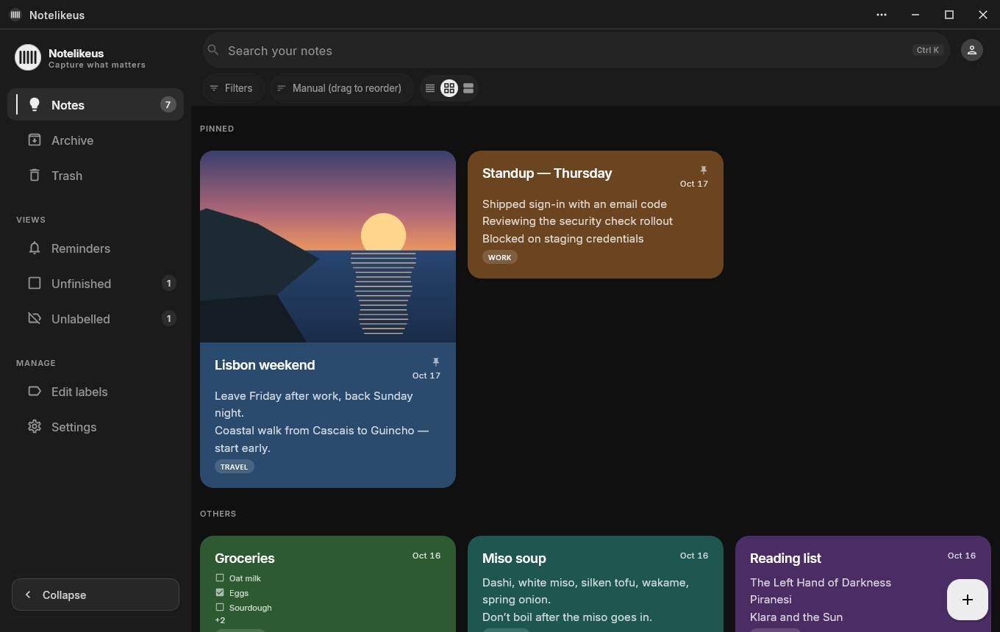
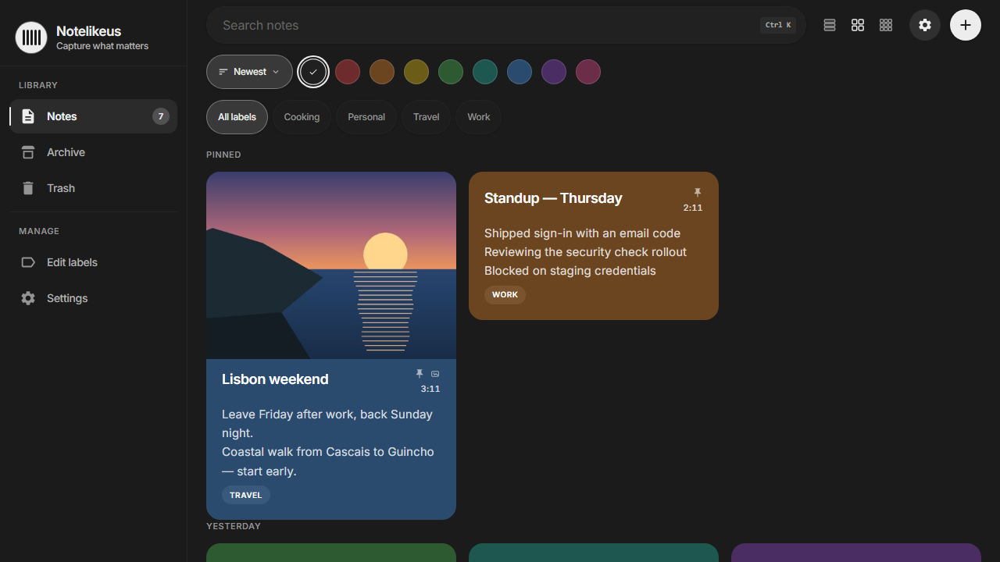
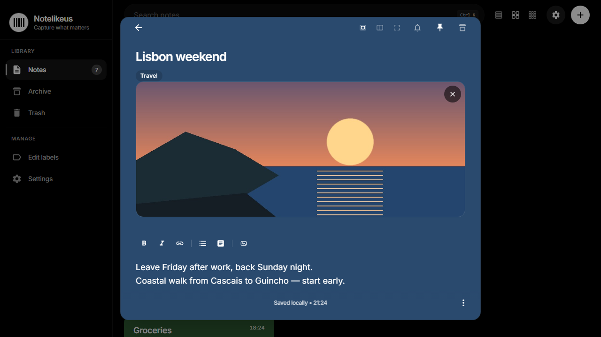
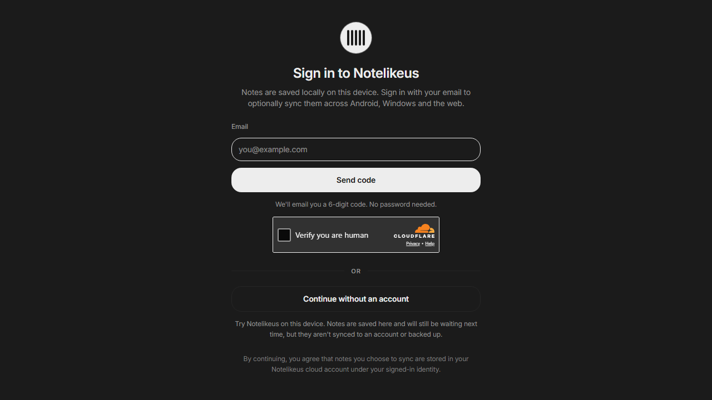
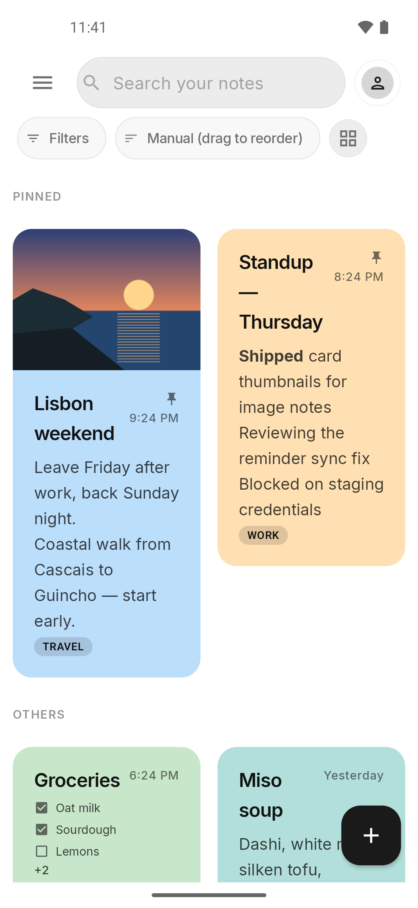
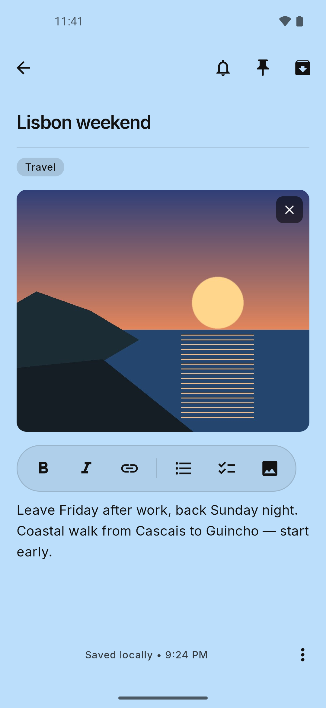
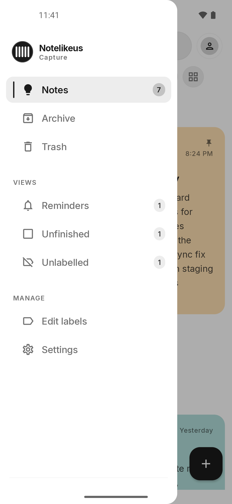
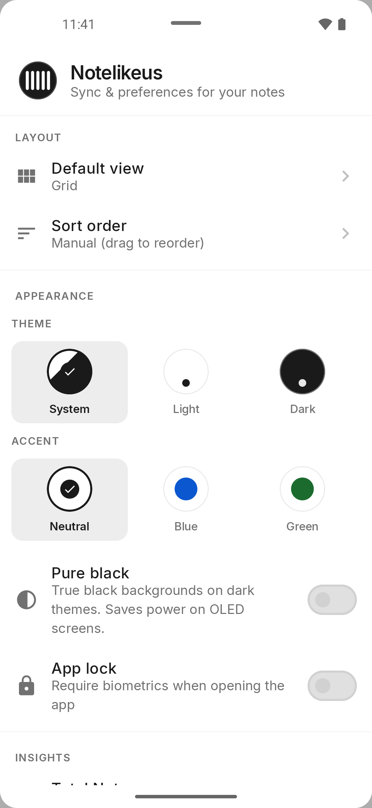

# Notelikeus

A Keep-style notes app for Android, Windows and the browser. Notes are written to local storage first; signing in is optional and only adds sync on top.

Android and Windows share a Kotlin Multiplatform core with a Compose UI. The web client is a separate React PWA that talks to the same Supabase schema.

- Web app: <https://notelikeus.pages.dev>
- Current version: [2.4.1](https://github.com/shareef01/notelikeus/releases/tag/v2.4.1)
- Backend details: [docs/BACKEND_ARCHITECTURE.md](docs/BACKEND_ARCHITECTURE.md)

## Screenshots

**Windows**



**Web**

 



**Android**

   

## Features

| | Android | Windows | Web |
|---|:---:|:---:|:---:|
| Notes, labels, checklists, colours | ✓ | ✓ | ✓ |
| Pin, archive, trash, search, filters | ✓ | ✓ | ✓ |
| List / grid / compact layouts | ✓ | ✓ | ✓ |
| Rich text (bold, italic, links, bullets) | ✓ | ✓ | ✓ |
| Multi-select and bulk actions | ✓ | ✓ | ✓ |
| Swipe actions with undo | ✓ | ✓ | ✓ |
| Manual reorder in list view | ✓ | ✓ | ✓ |
| Image attachments, with the first picture on the card | ✓ | ✓ | ✓ |
| Theme (follows the system by default), accent, pure black | ✓ | ✓ | ✓ |
| Conflict copies, with a side-by-side review | ✓ | ✓ | ✓ |
| Reminders, with presets and an exact date & time | Notifications | Tray, while the app runs | Service worker |
| Encrypted local database | SQLCipher | SQLCipher (DPAPI key) | WebCrypto (note bodies) |
| Biometric app lock | ✓ | — | — |
| Home-screen widget | Glance | — | — |
| Email code sign-in and cloud sync | Optional | Optional | Optional |
| Security check before the sign-in email | In-app screen | In your browser | On the sign-in screen |
| Usable with no account | ✓ | ✓ | ✓ |
| JSON backup import / export | ✓ | ✓ | ✓ |
| Backup with attachment bytes (`.nlkbak`) | ✓ | ✓ | ✓ |
| Sync diagnostics | ✓ | ✓ | ✓ |
| Installable PWA | — | — | ✓ |

Web keyboard shortcuts:

| Key | Where | Does |
|---|---|---|
| `/`, Ctrl/⌘+K, Ctrl/⌘+F | Note list | Focus search. With a note open, Ctrl/⌘+F is the browser's find. |
| N | Note list | New note |
| ↑ / ↓ | A card's drag handle | Move the note one place, in manual sort |
| Ctrl/⌘+B, Ctrl/⌘+I | Editor | Bold, italic (also on Android and Windows) |
| Ctrl/⌘+Enter | Editor | Save now |
| Ctrl/⌘+Z | Outside a text field | Undo, while the Undo toast is up |
| Escape | Anywhere | Close the innermost dialog, then the note, then leave selection |

Shortcuts on the note list stay out of the way while a dialog is open, and typing in a text field never triggers them.

## How it works

Notes are stored on the device. Android and Windows use Room with SQLCipher: Android seals the passphrase in the Android Keystore; Windows seals it with DPAPI. Attachment image bytes are AES-GCM sealed on both. The web client seals note titles, bodies, and checklists in IndexedDB (and staged pending attachment blobs) with WebCrypto AES-GCM — profile-at-rest only, not an XSS control. Nothing about the app requires an account.

Sync sits above that. When you sign in, notes replicate through Supabase: Postgres RPCs for mutations, Realtime as a wake-up signal, row-level security for isolation.

Signing in needs no password. You type your email, Supabase emails a 6-digit code, and you type the code in; the first sign-in creates the account. Before the code is sent, every client runs a Cloudflare Turnstile check, so a script cannot spend the project's sign-in emails and lock everyone else out. On the web the check sits on the sign-in screen, Android shows it in a short in-app screen, and Windows opens it in your browser and takes the answer back on a one-time local port. Codes expire after 10 minutes, and the hosted project refuses password sign-in outright, through a Custom Access Token hook, so nobody can set a password on an address before its owner signs in.

Conflicts are detected on a server-assigned revision rather than a client clock, so a device with a skewed clock cannot overwrite a revision the server has already confirmed. When two devices edit the same note before either syncs, neither edit is thrown away: the note keeps the version that reached the cloud first, and the other becomes a new note titled "… (conflicted copy)", taking with it any image that had not uploaded yet. Its "Conflict copy" tag opens a side-by-side review, where keeping one version moves the other to Trash. The same applies to a note open in the editor when another device changes it, and to a note edited on one device while it is deleted on another.

Deletions travel as tombstones, so a note deleted on one device stays deleted when another device syncs later. A note deleted before this device knew its server revision is deleted once a later sync shows the cloud copy still says exactly what was deleted; if it changed on another device in the meantime, it comes back and the app says so.

A cloud read that fails is not treated as an empty account. A fetch returning nothing where notes were expected refuses the sync rather than concluding everything was deleted.

Saved locally and synced are reported as different things. An edit counts as saved once Room or IndexedDB has taken it; a later network failure shows as sync pending, not as a lost note. If the local write itself fails, the editor stays open holding the text and offers a retry.

Attachments are written to durable local storage before the note references them, so a note that points at an image still has the bytes after a restart and the upload can resume. Blobs live in Cloudflare R2 behind a Worker that verifies the Supabase session and derives the object key from the authenticated user. Staged bytes are scoped to the account that created them.

An uploaded image becomes visible to other devices only when a note commit names it. Every client uploads through the Worker's `/v2/` route, which records the image as provisional, and then names it in the note's `apply_note_change`. An upload whose note never commits therefore cannot attach itself to an unrelated note that later reuses the id. Until that commit lands, the note keeps its own uploads through every sync. A cloud version written over a local note keeps the images that have not uploaded yet. If the commit that was to name an upload conflicts, the conflicted copy takes the image.

Importing a backup adds its notes as new notes rather than replacing what is on the device, so importing the same file twice gives you two copies. A JSON backup carries note content only. Every client can also export and import a `.nlkbak` bundle — a plain ZIP holding the same JSON document plus the attachment bytes this device actually has. Images that exist only in the cloud are left out and reported as skipped.

Something not syncing has a settings screen for it. Sync diagnostics shows counts, cursors and version numbers — never note text, tokens or your account id — and copying it anywhere is up to you.

## Stack

| Layer | Android / Windows | Web |
|---|---|---|
| UI | Compose Multiplatform | React 19, TypeScript, Tailwind |
| Structure | MVVM with shared repositories | Hooks and Zustand stores |
| Local data | Room + SQLCipher (Keystore / DPAPI) | IndexedDB (notes + pending attachments sealed) |
| Cloud | Supabase Auth, Postgres RPC, Realtime | Supabase Auth, Postgres RPC, Realtime |
| Attachments | Cloudflare Worker and R2 | Cloudflare Worker and R2 |
| Distribution | APK and MSI on [GitHub Releases](https://github.com/shareef01/notelikeus/releases) | Cloudflare Pages |
| Tooling | Koin, Coroutines, Flow | Vite, Vitest, Playwright |

## Getting started

Android 8.0 (API 26) is the minimum supported release, and the desktop build ships as a
Windows MSI. Building needs JDK 21 for the Gradle daemon and JDK 17 for the build, plus Node.js 24 for the web app;
the database suite needs Docker for the Supabase CLI.

```bash
npm install
npm run supabase:start
npm run supabase:reset
```

### Android

Signing in on a device needs a hosted Supabase URL compiled into the APK; debug builds do not fall back to localhost. `npm run setup:staging` writes the gitignored `web/.env.staging` that the next command reads.

```bash
npm run kotlin:staging-properties
./gradlew :androidApp:assembleDebug
```

See [docs/ANDROID_STAGING.md](docs/ANDROID_STAGING.md) for the keys involved. Release builds (the AAB and the MSI) refuse to build without the hosted Supabase URL, the public client key, the attachments Worker URL and `NOTELIKEUS_CAPTCHA_PAGE_URL`, the web app's security-check page.

The public client key is the project's publishable key (`sb_publishable_…`). Builds still accept a legacy anon JWT (`eyJ…`) and refuse any secret key, but the hosted project has had its legacy JWT keys disabled since 2026-10-21, so a build carrying one cannot reach it (D31 in [docs/DECISIONS.md](docs/DECISIONS.md)). The variables keep their `ANON_KEY` names.

### Windows

```bash
./gradlew :composeApp:run          # run from source
./gradlew :composeApp:packageMsi   # build the installer
```

### Web

```bash
cd web
npm install
cp .env.example .env
npm run dev
```

Production builds need a hosted `VITE_SUPABASE_URL`, and the publishable key in `VITE_SUPABASE_ANON_KEY`. A deploy refuses a build that contains a secret key. With `VITE_TURNSTILE_SITE_KEY` set, the sign-in screen and `captcha.html` run the Turnstile check; without it, as in local development and e2e, no check is shown and no token is sent.

## Testing

| Suite | Covers | Command |
|---|---|---|
| Kotlin lint | detekt, against the baseline in `config/detekt/` | `./gradlew detekt` |
| Kotlin unit | Sync engine (incl. conflict copies and verified deletes), mappers, repositories, backup, key management, Room migrations, reminder time zones, theme contrast | `./gradlew :composeApp:testDebugUnitTest :composeApp:desktopTest :androidApp:testDebugUnitTest` |
| Cross-client contracts | Backup and cloud payload formats, asserted from the same fixtures by Kotlin and TypeScript | part of the Kotlin unit and web unit suites |
| Sync invariants | Crash, offline, account-switch and restore interleavings against a fault-injecting transport | part of the Kotlin unit suite |
| Instrumented | Database quarantine and encryption migration, on a device | `./gradlew :composeApp:connectedDebugAndroidTest` |
| Minified release | R8 and resource shrinking | `./gradlew :androidApp:assembleRelease` |
| Web unit | Merge logic, conflict resolution and review, backup parsing, bundle archives, diagnostics redaction, search, theme contrast | `cd web && npm test` |
| Web end-to-end | Built bundle in Chromium against local Supabase | `cd web && npm run test:e2e` |
| Database | RLS, sync RPCs, tombstones, attachments, the password sign-in hook (pgTAP) | `npm run supabase:test` |
| Attachments Worker | JWT auth, path isolation, size and MIME limits | `npm run test:attachments-worker` |
| Pages artifacts | `_headers` and `_redirects` in `web/dist`; before a deploy, also that no secret key is in the bundle | `npm run pages:verify` |
| Ops scripts | The bundle secret scan, the client-key checks for staging builds, the Worker's generated deploy config | `npm run test:pages-bundle-secrets`, `npm run test:kotlin-staging-properties`, `npm run test:attachments-worker-deploy` |

The instrumented suite needs a connected device or emulator; the database and end-to-end suites need a running local Supabase (`npm run supabase:start`), which needs Docker.

The cross-client fixtures live in [`contracts/`](contracts/) and are read by both test suites, so a
field renamed or defaulted differently on one client fails on both. `contracts/sync/` pins the rules for what an incoming cloud version may do to a local note. The most recent audit is
[`docs/audit/PROJECT_AUDIT_2026-10-21.md`](docs/audit/PROJECT_AUDIT_2026-10-21.md) (publishable keys, deploy checks, and an Android image fix), which builds on
[`2026-10-19`](docs/audit/PROJECT_AUDIT_2026-10-19.md), [`2026-10-17`](docs/audit/PROJECT_AUDIT_2026-10-17.md), [`2026-10-15`](docs/audit/PROJECT_AUDIT_2026-10-15.md) and [`AUDIT_REPORT.md`](AUDIT_REPORT.md). Each records the status of every finding. The earlier
[`docs/audit/COMPREHENSIVE_AUDIT.md`](docs/audit/COMPREHENSIVE_AUDIT.md) with [`docs/audit/FINDINGS.md`](docs/audit/FINDINGS.md), and the design system in [`docs/design/`](docs/design/), sit alongside them.

## Repository layout

| Path | Contents |
|---|---|
| `androidApp/` | Android application module: manifest, AppFunctions, widget metadata |
| `composeApp/` | Shared Kotlin Multiplatform UI, domain, Room, and the Windows desktop target |
| `web/` | React PWA |
| `supabase/` | Postgres migrations, seed data, pgTAP tests |
| `workers/attachments/` | Cloudflare Worker for R2 authorization |
| `cloudflare/` | Pages header parity check |
| `contracts/` | Canonical JSON fixtures both clients are tested against |
| `docs/` | Architecture, design decisions, known defects, audits, device QA |
| `store/` | Play Store listing copy and publishing notes, kept for a future Play release; releases currently ship on GitHub only |

## Privacy

Guest notes never leave the device. Signed-in notes sync to your own Supabase account, protected by row-level security and authorized RPCs rather than end-to-end encryption. There is no analytics or tracking SDK in any client. See [PRIVACY_POLICY.md](PRIVACY_POLICY.md).

## Maintainer

Built and maintained by [@shareef01](https://github.com/shareef01). Issues and pull requests are welcome; see [CONTRIBUTING.md](CONTRIBUTING.md) and [SECURITY.md](SECURITY.md).

## License

All rights reserved. No licence is granted for reuse or redistribution.
