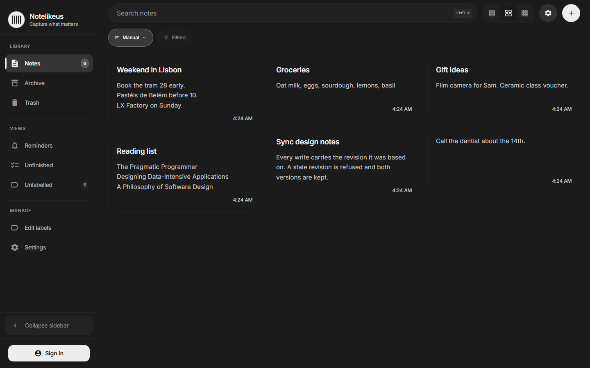
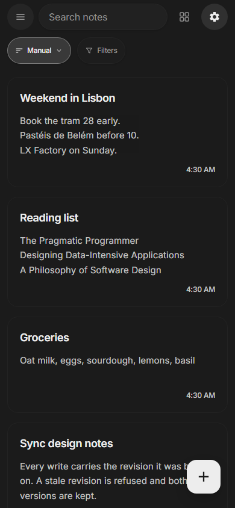
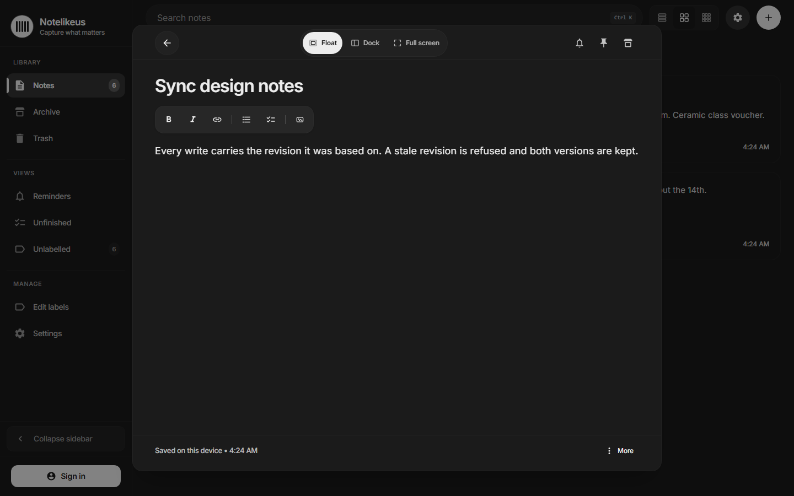
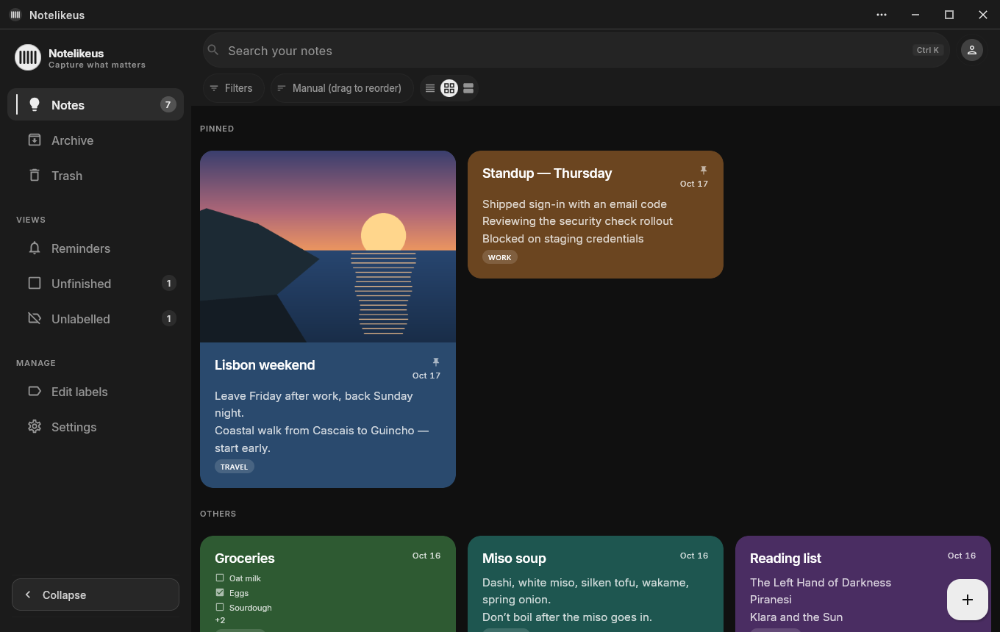
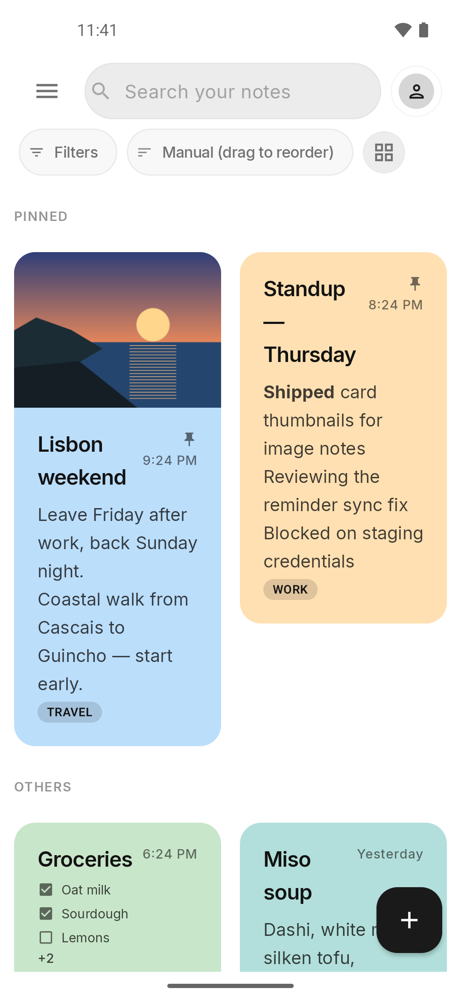
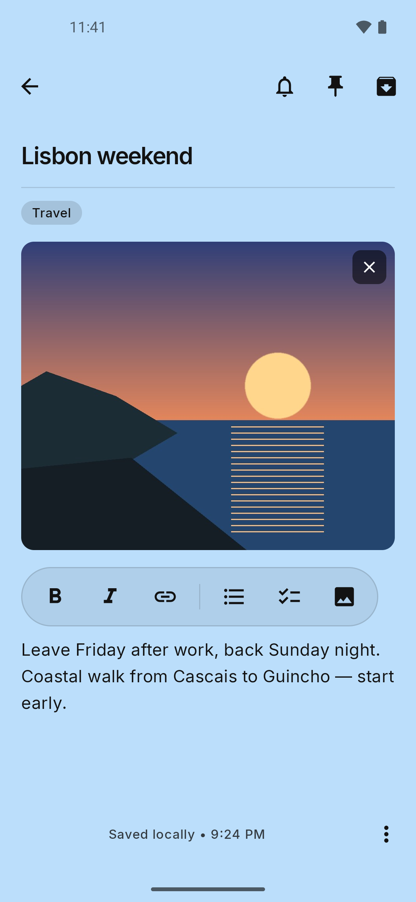

# Notelikeus

**A local-first notes app for the web, Android and Windows: it works fully offline without an
account, and syncs across devices when you sign in without ever silently overwriting an edit.**

[**Open the web app**](https://notelikeus.pages.dev) · [Download for Android and Windows](https://github.com/shareef01/notelikeus/releases/latest) · [Architecture](docs/BACKEND_ARCHITECTURE.md) · [Design decisions](docs/DECISIONS.md)

| Web, desktop | Web, phone | Editor |
|---|---|---|
|  |  |  |

| Windows | Android |
|---|---|
|  |   |

## What it does

- **Notes, checklists and labels** with pinning, colours, archive and trash, plus search with operators (`label:`, `is:pinned`, `before:`) and saved filters.
- **Rich text** (bold, italic, links, lists) and **images**, stored on the device first and uploaded later.
- **Reminders** through system alarms on Android, the tray on Windows and the service worker on the web.
- **Offline without an account.** "Continue without an account" keeps everything in the browser or on the device. Signing in later adds sync.
- **Encrypted storage on the device**: AES-256-GCM sealed storage wrapped with Windows DPAPI on the native Rust Windows client (`%APPDATA%\NotelikeusRust`), SQLCipher (key in the Android Keystore or Windows DPAPI) on Kotlin clients, and WebCrypto AES-GCM in IndexedDB on the web.
- **Backups** you can move between platforms: a `.nlkbak` archive with images, or plain JSON.
- **Account deletion** from every client, which also removes the account's images from storage.

What each platform adds (biometric lock and widget on Android, tray reminders on Windows): [features by platform](docs/PLATFORM_FEATURES.md).

## How sync works, in plain English

1. **Your device is the source of truth for what you just typed.** Every edit is saved locally first and queued. Losing the connection just means the queue waits.
2. **The server numbers every change.** Each note has a revision. When a device uploads an edit, it says which revision it started from.
3. **Stale edits are never applied blindly.** If another device changed the note in the meantime, the server refuses the upload. The device then keeps **both** versions: the cloud's on the original note and yours as a "(conflicted copy)". You can compare them side by side.
4. **Deletions stick.** A deleted note leaves a tombstone, so a device that was offline cannot bring it back.
5. **"Delete cloud data" means it.** A wipe raises a server-side generation number that every later upload must present, so an old device that reconnects cannot re-upload what you deleted.
6. **Accounts stay separate.** Local data is stored per account, and requests in flight during a sign-out or account switch cannot write into the next account.

A device's clock never overrides a revision the server has confirmed: the revision check decides.

## Architecture

```
 Web PWA (React, IndexedDB)    Android (Compose, Room)    Windows (Rust/Slint or Compose Desktop)
            │                          │                             │
            └──────────── revision-checked RPCs over HTTPS ──────────┘
                                       │
                 Supabase: Postgres + row-level security + Auth + Realtime
                                       │
                 Cloudflare Worker ─── R2 (images, keyed by owner and note)
```

- **Supabase** stores notes and enforces ownership with row-level security. Writes go through RPCs that check the revision, the wipe generation and storage quota in one transaction.
- **The attachments Worker** verifies the user's token and builds every storage key itself (`owners/{owner}/notes/{note}/attachments/{id}`), so one account can never name another's file. An upload stays provisional until a note revision references it; a sweep reclaims anything orphaned.
- **Shared contracts** in [`contracts/`](contracts/) (note colours, theme palettes, query parser vectors, sync scenarios, backup fixtures) are tested by the Rust, Kotlin, and TypeScript clients, so all platforms agree on the data model.

More detail: [backend architecture](docs/BACKEND_ARCHITECTURE.md), [local encryption at rest](docs/LOCAL_ENCRYPTION_AT_REST.md), [Rust migration audit](docs/RUST_MIGRATION_AUDIT.md), [decision record](docs/DECISIONS.md), [deployment runbook](docs/DEPLOYMENT_RUNBOOK.md).

## Stack

| Part | Built with |
|---|---|
| Web | React 19, TypeScript, TipTap 3, Zustand 5, Tailwind CSS 4, Vite, Workbox |
| Windows (native Rust) | Rust 2024, Slint 1.19 (Direct2D / FemtoVG / Skia), `aes-gcm` + Windows DPAPI (`CryptProtectData`), `ureq` + Schannel (`native-tls`) |
| Android and Windows (Kotlin) | Kotlin 2.4 Multiplatform, Compose Multiplatform 1.12, Room 2.8 with SQLCipher, Koin, Glance widget |
| Backend | Supabase (Postgres, PostgREST, Auth, Realtime), pgTAP tests |
| Storage | Cloudflare Workers and R2 |
| Quality | Cargo test + headless Slint UI tests, Vitest, Playwright with axe accessibility checks, Detekt, GitHub Actions |

## Quick start

Requirements: Node.js 24+, JDK 21 for Gradle, and Docker if you want the local Supabase stack.

```bash
git clone https://github.com/shareef01/notelikeus.git
cd notelikeus/web
npm install
npm run dev            # http://localhost:5173, choose "Continue without an account"
```

The web app works in guest mode without any backend. To try sync locally:

```bash
npm install            # from the repo root
npm run supabase:start
npm run supabase:reset
```

Desktop and Android:

```bash
cd desktop-rust && cargo run --release --locked -p nlk-native   # Native Windows desktop (Rust + Slint)
./gradlew :composeApp:run                                       # Kotlin/Compose Windows desktop
npm run kotlin:staging-properties && ./gradlew :androidApp:assembleDebug
```

## Tests and builds

| What | Command |
|---|---|
| Rust desktop fmt, clippy, unit/contract/UI tests | `cd desktop-rust && cargo fmt --all -- --check && cargo clippy --workspace --all-features --all-targets --locked -- -D warnings && cargo test --workspace --all-features --locked` |
| Web lint, types, unit tests | `cd web && npm run lint && npm run typecheck && npm test` |
| Web end-to-end (needs local Supabase) | `cd web && npm run test:e2e` |
| Web accessibility and reflow matrix (no backend) | `cd web && npm run test:audit-ui` |
| Web production build (needs a hosted Supabase URL) | `cd web && npm run build` |
| Attachments Worker | `npm --prefix workers/attachments test` |
| Database (pgTAP, needs Docker) | `npm run supabase:test` |
| Kotlin unit tests | `./gradlew :composeApp:desktopTest :composeApp:testDebugUnitTest :androidApp:testDebugUnitTest` |
| Kotlin static analysis | `./gradlew detekt` |

CI runs all of these. Twelve of them are required checks on `main`.

## Security and privacy: what it does and does not do

- **Encryption at rest, not end-to-end encryption.** Notes are encrypted on each device, but the server can read synced notes. Access is controlled by Supabase Auth and row-level security, not by keys only you hold.
- The web app keeps its Supabase session in `localStorage`, guarded by a strict Content Security Policy. A script injected into the page could still read it.
- Sign-in uses email one-time codes with Cloudflare Turnstile. There are no analytics or trackers in any client.
- Android ships only as a signed APK on GitHub Releases; it is not on Google Play.

See [SECURITY.md](SECURITY.md) and the [privacy policy](PRIVACY_POLICY.md).

## Repository layout

```
web/                  React PWA
desktop-rust/         Native Windows Rust workspace (nlk-native, notelikeus-app, notelikeus-core, nlk-tauri, nlk-cli)
composeApp/           Shared Kotlin: domain, sync engine, Room, Compose UI, desktop target
androidApp/           Android entry point, widget, App Functions
supabase/             Migrations and pgTAP tests
workers/attachments/  Cloudflare Worker for images in R2
contracts/            Cross-client fixtures and schemas
docs/                 Architecture, decisions, audits, runbooks
```

## License

All rights reserved. Copyright © 2026.
