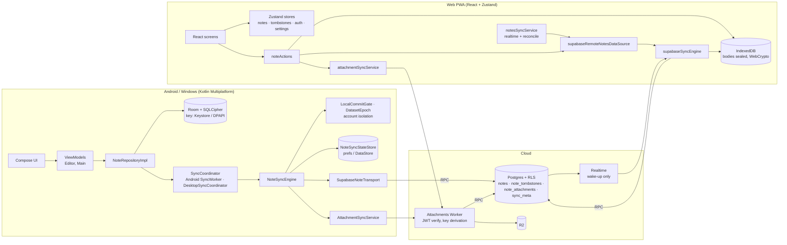
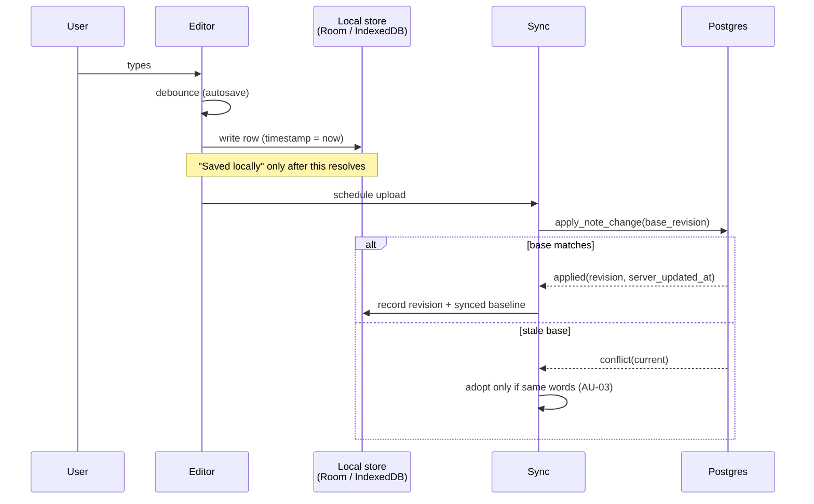
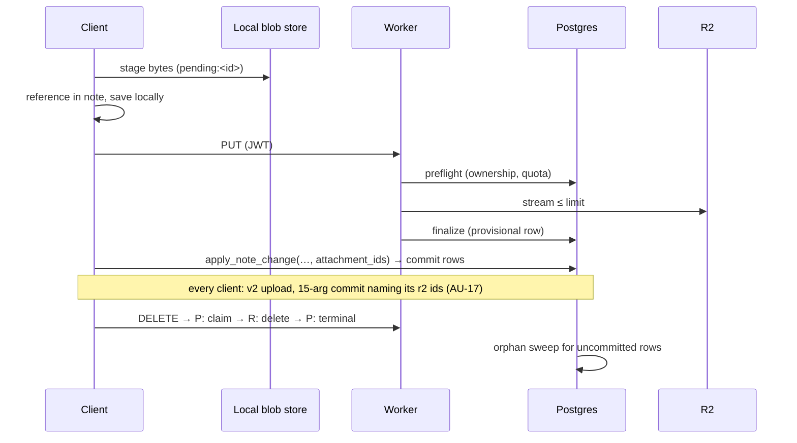
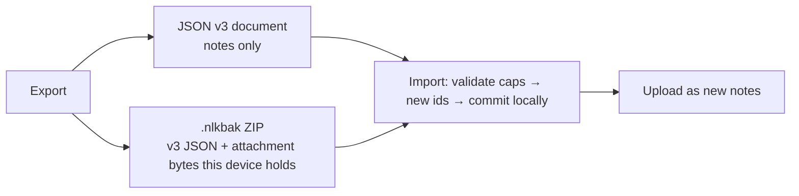

# Architecture review — October 2026

Baseline `3baed663`. Diagrams describe the code as read in this pass; where a step was taken from
migration or function names rather than traced line by line, it says so.

## 1. Overall architecture



**Assessment.** The split is sound: the two runtimes share a *protocol* (RPC signatures, payload
shape, cloud semantics) and the `contracts/` fixtures pin it, rather than forcing one codebase. The
cost is that every behavioural rule — and every defect — exists twice. This pass found the same
conflict defect (AU-01/02, AU-04/05) independently in both, which is the strongest argument for the
recommendation in §8.

## 2. Note creation and editing



## 3. Inbound synchronisation and conflict handling (after this pass)

The chart is the Kotlin download (`ConflictResolution.decide`). Web, after #316, gets the same end
states differently: an edited row carries a pending-push marker, every inbound apply skips marked
rows, and the queued push is sent against the marker's base revision — a conflict there keeps the
cloud version on the note and the local one as a conflicted copy (`pendingPushes.ts`).

```mermaid
flowchart TD
  IN[Incoming cloud version<br/>pull page · snapshot · reconcile] --> HAS{Local row?}
  HAS -- no --> ACC[Accept; record baseline]
  HAS -- yes --> ED{Edited here?<br/>row.timestamp ≠ baseline}
  ED -- no --> ACC
  ED -- yes --> SAME{Same words?}
  SAME -- yes --> ACC
  SAME -- no --> STAMP{Cloud stamp == row stamp?}
  STAMP -- yes --> KEEP[Keep local: pending edit<br/>on current revision → upload]
  STAMP -- no --> FORK[Insert local words as<br/>'… (conflicted copy)'<br/>then accept cloud version]
  FORK --> UP[Upload copy as a new note]
  ACC --> TX[Commit in one transaction<br/>web: abort + re-plan if a row changed meanwhile]
  FORK --> TX
```

Deletion arrives on the same path: a tombstone (or an id missing from a complete snapshot) for a row
that is *edited here* forks the row before the delete.

## 4. Deletion and restore

```mermaid
sequenceDiagram
  participant U as User
  participant L as Local
  participant T as Tombstones (local)
  participant P as Postgres
  U->>L: delete permanently
  L->>L: remove row
  L->>T: mark deleted (+ baseline revision if known)
  alt baseline known
    L->>P: apply_note_delete(base_revision)
    P-->>L: applied / idempotent / conflict
  else no baseline
    Note over L,P: nothing sent; next snapshot lets the cloud win<br/>→ note reappears silently (AU-07)
  end
  U->>L: Undo (restore)
  L->>T: mark restored, clear tombstone
  L->>P: restore_note
```

## 5. Attachment lifecycle

Taken from the Worker, client services and migration names
(`attachment_preflight_and_finalize`, `attachment_put_idempotency`, `attachment_delete_claim`,
`attachment_commitment`, `orphan_attachment_sweep`); the per-step SQL was audited in prior passes
(F46–F52) and not re-traced here.



## 6. Backup import / export



Imports always add notes under new ids (never overwrite), so an import cannot lose existing content;
the cost is duplicates on a repeated import (documented behaviour).

## 7. Local state that conflict preservation relies on

| Store | Web | Kotlin |
|---|---|---|
| Revision base per note | `LocalOwnerMeta.noteRevisions` | `knownServerRevisionById` |
| Unsynced-edit marker | `LocalOwnerMeta.pendingPushes` (#316: base revision + edit counter) | **Synced baseline (new)** `syncedTimestampById` (prefs `synced_timestamps` / DataStore `sync_synced_timestamps`) |
| Pull cursor | `lastRemoteRevision` | — (Kotlin reads full snapshots) |
| Tombstones + delete baselines | `tombstoneStore` | `deleted_at_by_id`, `baseline_delete_revisions` |

The Kotlin baseline is cleared with the rest of sync state on sign-out/account switch. Web markers
are namespaced by owner id and deliberately survive a switch (#316 keeps a previous account's
unsynced edits for that account), so neither can leak into another account.

## 8. Recommendations

1. **A shared conflict-rule contract — implemented.** The table in §3 is pinned by
   `contracts/sync/inbound-resolution.json` (13 cases) for Kotlin. The web client, after #316, detects
   unsynced edits with pending-push markers and resolves conflicts at push time, so it reaches the same
   end states by a different route; extending the fixture to web needs an adapter that drives #316's
   pull + flush path per case.
2. **Server-side conflict hint.** `apply_note_change` already returns `current`; returning the
   revision the client's base corresponds to would let clients detect "edited on top of a stale
   base" without a local baseline. Optional; the client-side baseline is sufficient.
3. **Do not merge the runtimes.** Moving the web onto Kotlin/Wasm would trade a well-tested React
   client for a large migration with no data-safety gain. Contract fixtures give most of the benefit.
